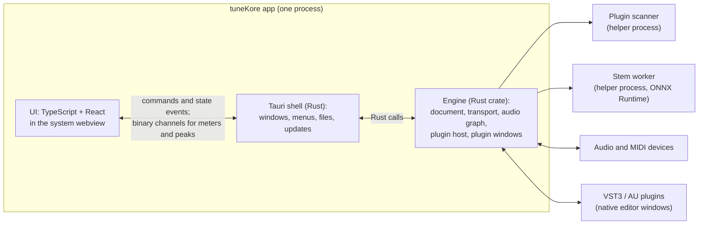

# tuneKore plan

tuneKore is a lightweight Ableton-style DAW that devKore owns outright: a
platform to build our own instruments, effects and tools on. It runs on macOS
first, then Windows, then Linux. It hosts the plugins Nate already owns (Serum 1
and 2 through Splice Rent-to-Own, Arturia V Collection, Native Instruments). The
first tool is the **Analyzer**, a separate window that splits a song into stems
and lets you work on one stem at a time.

Written 2026-10-23. The licensing facts were checked on the web that day; the
Ableton behavior comes from Ableton's own manual and release notes. Sources are
at the end. On 2026-10-24 the engine moved from C++ to Rust after a plugin
hosting test (see "Why Rust" below). The same day the product was renamed
from musiKore to tuneKore; the logo is "TUNE K›".

## 1. Decisions

| Area | Choice | Why |
| --- | --- | --- |
| Engine | Our own engine in Rust: the `tunekore-engine` crate, in one Cargo workspace with the shell | No garbage collector on the audio thread, memory safety in our own code, and one language and build from the engine to the shell. Plugin hosting from Rust is proven on Serum 1 and 2 (see "Why Rust"). Every line is ours. |
| UI | TypeScript and React in the system webview, with Canvas and WebGL for the timeline, waveforms and meters | Fast to build and change, and it matches the stack Nate already works in. The UI never runs on the audio thread. |
| App shell | Tauri 2 (MIT/Apache) | Windows, menus, dialogs, installers, signing and auto-update on all three OSes, with a small app size. Its Rust commands call the engine crate directly. |
| Plugin formats | VST3 everywhere and Audio Units on macOS. CLAP later. No VST2. Hosted through the `vst3` crate (MIT/Apache bindings to the SDK) and `objc2-audio-toolbox` (Zlib/MIT/Apache). | The VST3 SDK has been MIT since 3.8 (Oct 2025). Steinberg no longer licenses VST2 to new hosts. All of Nate's plugins ship as VST3 and AU; none ship CLAP. |
| Audio and MIDI I/O | cpal (Apache-2.0) and midir (MIT) | CoreAudio, WASAPI, ASIO, ALSA and JACK behind one API |
| Audio files | Symphonia (MPL-2.0, used unmodified) for WAV, AIFF, FLAC, MP3 and Ogg, plus the OS decoders for AAC/M4A | Pure Rust, and no LGPL dependency to manage |
| Time-stretch | Signalsmith Stretch (MIT), through a thin binding to its C++ header | Good quality with no license fee. Bungee (MPL-2.0) is the backup. |
| Resampling | rubato (MIT/Apache) | Pure Rust. r8brain-free (MIT, C++) is the backup. |
| Stems | A separate worker process running ONNX Runtime (MIT) through the `ort` crate (MIT/Apache), on Core ML on Apple silicon | The model is still open: see section 6. |
| Project files | Our own format: a `.mkore` folder with `project.json`, `audio/` and `plugins/` | We read Ableton `.als` files later, if ever; we never copy the format. |

### Why not JUCE

JUCE is the usual way to build this and the fastest to a working plugin host.
We leave it out for three reasons:

- **The free tier won't cover us.** JUCE 9 (July 2026) is free only under $20k
  of annual revenue. For a company, that is the company's total revenue, so Kore
  LLC's consulting income counts. Shipping closed source then costs $800
  (Indie, under $300k) or $3,500 (Pro) per seat, and the terms are set by PACE,
  which owns JUCE.
- **The main reason to use it is gone.** VST3 hosting was the hard part to do
  without JUCE, and Steinberg's SDK is now MIT.
- **A licensed framework would sit under every line.** Owning the IP is the
  point of the project.

Tracktion Engine would hand us a whole DAW engine, but it needs a JUCE license
as well as its own ($35 to $300 a seat a month, or GPL), and the core of the
product wouldn't be ours.

**Fallback.** If plugin hosting eats more than its share of Phase 2, JUCE's
plugin layer can go behind our `PluginHost` interface, as a small C++ library
with a C interface. That decision would cost a JUCE license, not a rewrite.

### Why Rust

The first plan chose C++, because hosting VST3 and AU editors from Rust looked
like the least proven path. On 2026-10-24 a test host in Rust settled it
(idevkore/kore-issues#24, branch `nate/chore/rust-hosting-spike`,
`spike/FINDINGS.md`):

- Serum 2 and Serum 1 loaded as VST3 and as AU. Their editors opened in native
  windows, they played notes at 120 BPM with transport sent every block, and
  their state saved and restored. Callbacks used under 10% of their budget.
- It took about 1,000 lines of Rust. Writing by hand what the SDK's C++
  hosting helpers would provide (messages, attribute lists, streams, event
  lists) was the bulk of it, and it was not hard.
- Analog Lab V and Jup-8 V4 failed, but Apple's `auval` fails them the same
  way, so the cause is their licensing on that Mac, not Rust.
- **One thing Rust can't do:** catch a C++ exception that a plugin throws. It
  aborts the process. Every call into a plugin therefore goes through a few
  lines of C++ that catch it and return an error, or the plugin runs out of
  process.

The plugin-boundary code is `unsafe` either way. What Rust adds is safety in
everything we write on our side of it (document, graph, queues), and one
toolchain for the engine and the shell.

### Other options considered

| Option | Verdict |
| --- | --- |
| C++20 engine (CMake, RtAudio) | The first choice, and Phase 0's first draft. It puts us next to the SDKs' reference code, but adds a second language, a CMake build and a C bridge to the Rust shell. The hosting test showed Rust doesn't need that. |
| Electron | Same UI idea as ours, but a heavy app |
| Swift / AppKit only | Best on a Mac, but it closes off Windows and Linux |
| Qt | LGPL obligations or a costly commercial license, and a C++ UI |

## 2. Architecture

### The engine

- **Document model.** Tracks, clips, devices, automation and the tempo map.
  The main thread owns it. Each edit publishes an immutable snapshot to the
  audio thread through a lock-free queue, so the audio thread never takes a
  lock.
- **Audio graph.** Each track's chain runs as one task on a worker pool, so
  tracks run in parallel. Returns, groups and the main track sum after their
  sources.
- **Delay compensation.** Every plugin reports its latency, and the graph
  delays the other paths to match. Input-monitored tracks get a low-latency
  mode, as in Live.
- **Transport.** One beat clock drives both the timeline and the clip grid,
  with launch quantization. Plugins get tempo, position and play state every
  block. Serum's synced LFOs and Splice Bridge depend on this.
- **Real-time rules.** No allocation, locks, logging or file I/O on the audio
  thread. LLVM's RealtimeSanitizer, through the `rtsan-standalone` crate
  (Apache-2.0), enforces this in the debug build and in CI.
- **Long audio.** Files stream from disk with read-ahead. Short samples are
  cached in RAM.

### Plugin hosting

- **Scanning** runs in a helper process, so a plugin that crashes during the
  scan can't take down the app (Live has done this since 10.1). Results are
  cached and rescanned on demand.
- **VST3.** Through the `vst3` crate's bindings, with our own host-side
  classes in place of the SDK's C++ hosting helpers (module loading, host
  context, messages, streams, event lists; see "Why Rust"). We
  implement `IPluginFactory3::setHostContext`, which Serum 2's Linux build
  requires. We support event lists, parameter changes, the process context,
  sidechain and extra output buses (Kontakt), and state through
  `getState`/`setState`.
- **Audio Units.** Through AudioToolbox. AUv2 loads in process; AUv3 can load
  out of process. Editors come from `kAudioUnitProperty_CocoaUI` or
  `requestViewController`.
- **C++ exceptions** thrown by a plugin are caught by a small C++ shim around
  each plugin call, since Rust can't catch them.
- **Editors** open in their own native windows, as in Live. They float over the
  main window, and their titles follow the track name.
- **Automation.** Each plugin parameter can be automated sample-accurately in
  VST3 and at block rate in AU.
- **macOS signing.** We ship a notarized Developer ID build, not through the
  Mac App Store, since the sandbox would block plugins. Entitlements needed:
  - `com.apple.security.cs.disable-library-validation`: required to load other
    developers' plugins.
  - `allow-unsigned-executable-memory` and `allow-jit`: some plugins need them.
  - `com.apple.security.device.audio-input`, with a microphone usage string.

### UI and engine messages

- **Commands** from the UI ("add track", "load plugin", "set parameter") are
  small JSON messages. The engine answers with state events, and the UI keeps a
  read-only mirror of the document.
- **Fast data** (meters at 30 Hz, the playhead) goes over binary channels.
- **Waveform peaks** are computed in the engine and fetched from a custom
  `tunekore://peaks/...` URL.

## 3. What we take from Ableton, and in what order

We copy the workflow, never the code, art, names or content. The names column
below is ours.

| Live (manual) | tuneKore name | When |
| --- | --- | --- |
| Stem separation (12.3, Suite) | Analyzer → Stems | Phase 1 |
| Plug-in devices, plug-in windows, rescan | Plugins | Phase 2 |
| Arrangement View, audio and MIDI clips, recording, MIDI editor, automation | Timeline | Phase 3 |
| Session View: clip slots, scenes, launch quantization, stop buttons | Clip Grid | Phase 4 |
| Follow Actions | Clip Grid rules | After Phase 4 |
| Mixer: sends and returns, group tracks, Main track, sidechain, delay compensation | Mixer | Phase 5 |
| Freeze, flatten, export, render stems | Bounce and Export | Phase 5 |
| Browser, Places, plugin browser, preview | Library | Phase 6 |
| Splice in the browser (12.3) | Library → Splice | Phase 6 (local folder); full search needs a partnership |
| Warping, warp markers, auto-warp, warp modes | Warp | Phase 7 |
| Live Projects, Collect All and Save, File Manager | Projects | Phase 3, grows over time |
| Racks, Drum Racks, built-in instruments and effects | Our own devices | Later. This is where tuneKore becomes ours. |

## 4. Roadmap

devKore works in one-week sprints with a Thursday release. Sizes are rough:
one person directing AI agents. The repo moves to weekly releases once there is
something to release.

| Phase | Goal | Done when | Size |
| --- | --- | --- | --- |
| 0. Skeleton | Repo, Tauri shell with the brand, engine library building inside it, CI | The app opens on the Mac, lists audio devices and plays a test tone; CI builds macOS (and compiles on Windows and Linux) | 1 sprint |
| 1. Analyzer: stems | Analyzer window: open a song (WAV, AIFF, FLAC, MP3, M4A), split it into Vocals, Drums, Bass and Other, then play, solo, mute and export the stems | A 4-minute song separates on this Mac in under 2 minutes in fast mode. Stems line up with the original to the sample and sum back to it within the model's error. | 2 sprints |
| 2. Plugins | Scanner, VST3 and AU instruments and effects, editor windows, MIDI keyboard input, state saved with the project | Every plugin in the test list (section 5) loads, plays, opens its editor and comes back after save and reopen | 3 sprints |
| 3. Timeline | Tracks, audio and MIDI clips, recording, MIDI editor, automation lanes, undo | A short song can be recorded with Serum and Arturia, saved and reopened | 4 sprints |
| 4. Clip Grid | Clip slots, scenes, launch quantization, recording into slots, moving clips to the Timeline | Scenes launch on the bar, in sync with the Timeline's clock | 2 sprints |
| 5. Mixer and export | Sends and returns, groups, sidechain, delay compensation, bounce, freeze, export | A test set with high-latency plugins exports sample-aligned | 3 sprints |
| 6. Library and Splice | Places (including `~/Splice`), search, preview in tempo, drag and drop | Splice samples and Splice Bridge work in a set | 1 sprint |
| 7. Warp | Signalsmith Stretch, warp markers, tempo detection | A song from the Analyzer follows the set's tempo | 2 sprints |
| 8. Windows | WASAPI and ASIO, VST3, WebView2, signed installer | The plugin test list passes on Windows | 2 sprints |
| 9. Linux | ALSA, JACK and PipeWire, VST3, WebKitGTK, Flatpak or AppImage | Serum 2 (native beta) plays | 2 sprints |

Phase 1 comes first, as asked. It needs only the shell, the audio output and
the stem worker, so it ships before plugin hosting.

## 5. Plugins and hardware: what "support Serum, Arturia and Splice" means

On this Mac every plugin is installed as both AU and VST3, with no CLAP:

- **Xfer:** Serum, Serum 2
- **Arturia V Collection:** Analog Lab V, about 30 V instruments (Jup-8 V4,
  Mini V4, Prophet-5 V, CS-80 V4, DX7 V and others), the Augmented series and
  Efx REFRACT
- **Native Instruments:** Kontakt 7, Massive, Reaktor 6, Guitar Rig 7, Solid
  Bus Comp, Komplete Kontrol, Maschine 2

Nate's Splice account (Apps & Plugins, 2026-10-24) also has these. Only Serum
and Serum 2 are installed so far:

| Splice app | Version | What it is | Status |
| --- | --- | --- | --- |
| Instrument | 2.5.4 | Splice's own instrument, with preset libraries | Not installed |
| Sounds Plugin | 0.15.0 beta | Browse Splice sounds, Search with Sound and Variations inside a DAW | Not installed |
| Astra | 1.2.7 | Synthesizer and sequencer | Not installed |
| Beatmaker | 1.3.1 | Drums and sequencer | Not installed |
| Bridge | 5.1.1 | Plays Splice previews in the DAW's key and tempo | Not installed |
| Serum | 1.368 | Rent-to-Own, now owned | Installed |
| Serum 2 | 2.1.5 | Rent-to-Own, now owned | Installed |

Serum and Serum 2 show as owned, so their licenses no longer depend on Splice.
The other Splice apps install as ordinary plugins. Check their formats (AU,
VST3) once they're installed. Astra and Beatmaker sequence to the host's clock,
and may send MIDI out, so the host must route a plugin's MIDI output to other
tracks.

| Plugin | macOS | Windows | Linux |
| --- | --- | --- | --- |
| Serum 1 | AU, VST3 | VST3 | Only through yabridge (Wine), with a workaround |
| Serum 2 (Splice Rent-to-Own) | AU, VST3 | VST3 | Native VST3 public beta since Aug 2026. Unknown whether a Rent-to-Own license unlocks it. |
| Arturia V Collection 11 | AU, VST3 | VST3 | None. yabridge is stuck on Wine 9.21, so activation is hit or miss. |
| Native Instruments | AU, VST3 | VST3 | None. Native Access 2 fails under Wine. |
| Splice Instrument, Astra, Beatmaker, Bridge, Sounds Plugin | AU, VST3 (to confirm) | VST3 | None |

**Phase 2 test list** (in order): Serum 2, Serum, Analog Lab V, one heavy V
instrument (Jup-8 V4), Kontakt 7 (multiple outputs), Guitar Rig 7 (effect),
Solid Bus Comp (sidechain), Splice Instrument, Astra and Beatmaker (synced to
the host's clock), Splice Bridge.

**Splice** support comes in three layers:

1. **Serum through Rent-to-Own.** The Splice desktop app authorizes the plugin,
   so it needs to be installed and logged in. Serum is then a normal plugin, and
   our host needs nothing Splice-specific. Once it's paid off, the license
   moves to the Xfer account and Splice isn't needed at all.
2. **Samples.**
   - The Splice app downloads to `~/Splice`. The Library adds it as a place.
   - Dragging a sample from the Splice app into tuneKore works like any file
     drop.
   - Splice Bridge and the new Splice Sounds plugin are ordinary VST3/AU
     plugins, so they work once Phase 2 does, as long as we send tempo and
     transport.
3. **In-app catalog search, like Live 12.3.** Splice has no public API. Live,
   Studio One and Pro Tools each did a partnership deal. That is a business
   conversation for later, not a coding task.

**Hardware.** Nate will send a list of the hardware tuneKore needs to work with.
Until then, this is what any host needs:

- **Audio interfaces:** any CoreAudio device on macOS, ASIO and WASAPI on
  Windows, and ALSA, JACK and PipeWire on Linux.
- **MIDI keyboards and controllers:** class-compliant USB MIDI through CoreMIDI
  (and the Windows and Linux equivalents), plus MIDI learn to map any knob or
  fader to a parameter.
- **MIDI out and clock:** send notes and MIDI clock to external synths and
  drum machines, and compensate for their latency.
- **Control surfaces:** devices with their own protocol (for example Komplete
  Kontrol or Maschine keyboards) need a script per device. Support comes per
  device, from the list.

Each item on the list gets a row here: device, connection, what it should
control, and the phase it lands in.

## 6. The Analyzer and stems

**What Live does.** Live 12.3 Suite splits audio locally into Vocals, Drums,
Bass and Others:

- It has two modes. High Speed does one pass. High Quality runs a dedicated
  pass for each of Vocals, Drums and Bass, and Others is what remains.
- "Separate Stems to New Audio Tracks" puts the stems in a new group track and
  mutes the source clip.
- The model is licensed from Music AI, the company behind Moises.

**Our design.**

- **The Analyzer window.** Drop in a song; it decodes, separates and opens the
  stems in a small mixer. There you can play, solo and mute each stem, export
  it as WAV, or send the stems to tracks in a set.
- **The worker.** Separation runs in a separate process, so a 10-minute job
  never touches the audio thread and a crash only fails the job. It shows
  progress and can be cancelled.
- **Modes.** Fast and Best, like Live's two.
- **"Break out one stem"** is the hook for the tools Nate wants next: key and
  tempo detection, stem to MIDI, chop to a sampler, send to a plugin chain.

**The model: a license decision before anything ships.**

- The best open model, Demucs (htdemucs), has MIT code. Its trained weights,
  in the author's words, are "provided only for scientific purposes."
- Most open weights, the RoFormer models included, are trained on MUSDB18-HQ,
  a non-commercial dataset.
- That leaves three ways forward:

| Path | Cost | Fits "own the IP" |
| --- | --- | --- |
| Prototype on Demucs privately, then license a commercial model (Music AI, AudioShake, or similar) before shipping | A license fee | We own the app; the model is rented. |
| Train our own model on licensed or owned multitrack audio, using MIT code (Demucs or BS-RoFormer architectures) | The data is the hard part | Fully ours |
| Ship with no built-in model and let users run a model they supply | None | Weak product |

The model sits behind a `Separator` interface, so it can be swapped without
touching the Analyzer.

**Decision (Nate, 2026-10-24): the first path.**

- **Phase 1 builds on Demucs (htdemucs)**, running on Nate's Mac only. The
  weights are downloaded on that machine and never committed, bundled or
  shipped.
- **Phase 1 also tests SAM Audio** against Demucs (details below). If its
  quality and speed hold up on Nate's Mac, it could ship without a paid
  vendor.
- **Before tuneKore ships to anyone,** a model we have the right to ship
  replaces Demucs behind `Separator`: SAM Audio if it passes, otherwise a
  licensed vendor model. The vendors are being contacted now, in parallel,
  since deals like this take weeks.

**SAM Audio (candidate).** Meta's general sound separator, released December
2025 (github.com/facebookresearch/sam-audio). It isolates whatever a prompt
names ("vocals", "drums"), with small, base and large checkpoints. Of every
open separation model checked on 2026-10-24, it and Spleeter are the only ones
whose weights we could ship (see "What tuneKore can ship" below).

| SAM License (dated 2025-11-19) | What it means for tuneKore |
| --- | --- |
| A worldwide, royalty-free license to use, copy, modify and redistribute, and to make derivative works. It sets no revenue or user cap and doesn't restrict commercial use. | We can bundle it and charge for tuneKore. |
| Redistributing it requires including a copy of the license. | tuneKore ships the license text with the model. |
| No reverse engineering the model, and no prohibited uses such as military or warfare. | No effect on a DAW |
| Meta can end the license if we breach it, and we would then have to delete the model. | Stick to the terms. |
| We own the derivative works we make, but Meta keeps ownership of SAM itself. | Fine-tuned versions are ours to use under the same license. |
| The checkpoints are gated: request access on Hugging Face before downloading. | Nate requests access. |

The SAM License is Meta's own, not one of the open licenses `CLAUDE.md`
allows, so shipping SAM Audio needs Nate's explicit exception there.

**What Phase 1 tests**, on the same songs and the same Mac, SAM Audio against
Demucs:

- Separation quality on four stems (vocals, drums, bass, other), by listening
  and by SDR scores on test tracks we have the rights to.
- Speed and memory on Apple silicon. The README targets NVIDIA GPUs and says
  nothing about Apple silicon, so the smallest checkpoint that sounds good
  enough matters.
- How well "other" works. SAM Audio pulls out what a prompt names, so "other"
  is likely the mix minus the three named stems.

**The other open models checked**, none of which can ship:

- **Open-Unmix `umxl`:** non-commercial weights (CC BY-NC-SA 4.0).
- **Open-Unmix `umxhq` and `umx`:** no stated weights license, trained on
  non-commercial data, and weaker (about 6 dB SDR against about 9 for
  Demucs).
- **Community RoFormer checkpoints:** no documented source or training data.
- **Demucs re-uploads tagged "MIT":** Hugging Face license tags are written by
  the uploader, and Demucs's author says its weights are for research only.

**Vendors** (the fallback if SAM Audio falls short):

| Vendor | What they offer | Contact | Status |
| --- | --- | --- | --- |
| AudioShake | Local Inference SDK: a native library for macOS (Apple silicon and Intel, on Metal and the Neural Engine), Windows, Linux, iOS and Android, with no cloud calls. It powers djay Pro's Neural Mix. | info@audioshake.ai, or Contact sales on audioshake.ai/products/sdk | Inquiry drafted, not sent |
| Music AI (Moises) | The model behind Live 12.3's stems. Its Embedded SDK runs "locally", from PCs to embedded Linux; terms by quote. | Contact Sales on music.ai | Inquiry drafted, not sent |
| zplane | STEMS EFFICIENT SDK: vocals, bass, drums and other. Terms not public. | licensing.zplane.de (in maintenance on 2026-10-24) | Not contacted |
| Gaudio Lab | GSEP separation as an API and an SDK; whether the SDK runs on a desktop isn't stated | "Talk to an expert" on gaudiolab.com | Not contacted |

What to ask each:

- Can the model run fully on-device in a desktop app (macOS first, then
  Windows and Linux)?
- Which stems are offered (at least vocals, drums, bass, other), and is there
  a fast and a high-quality mode?
- How is it priced: per seat, royalty, revenue share or a flat fee? Is there a
  startup tier?
- Is there an evaluation build to compare against Demucs on the same songs?
- What is the integration surface (C/C++ or Rust-friendly library, model
  format), and which hardware accelerators does it use (Core ML, Metal,
  DirectML, CUDA)?

Update the table as replies come in. The shipping model, SAM Audio or a
vendor's, is chosen by the end of Phase 1, so it can be in place before
Phase 8 (Windows) at the latest.

### What tuneKore can ship (checked 2026-10-24)

The question: what can a paid app ship for vocals, drums, bass and other,
running on the user's machine? Every licence below was read at its source:
the authors' paper or repo, the dataset's own record, or the vendor's own
pages. Hugging Face tags don't count. This is research for a product
decision, not legal advice; a vendor contract or a recording contract still
needs a lawyer.

| Option | Kind | Licence | Trained on, or what it is | Source | Fits `CLAUDE.md` |
| --- | --- | --- | --- | --- | --- |
| Spleeter `4stems` (Deezer) | Open model | MIT. Deezer's paper: "source code and pre-trained models are available on github and distributed under a MIT license" | Deezer's own catalogue (the private Bean set), "not trained, validated or optimized in any way with musdb18 data" | [JOSS paper](https://joss.theoj.org/papers/10.21105/joss.02154), [repo](https://github.com/deezer/spleeter) | Yes |
| AudioShake Local Inference SDK | Vendor | Commercial; terms and price not public | Native library for macOS (Apple silicon and Intel), Windows, Linux, iOS and Android; encrypted model files | [SDK docs](https://developer.audioshake.ai/sdk/overview.md) | Needs an exception (proprietary) |
| Music AI Embedded SDK | Vendor | Commercial; by quote | Runs "locally", from PCs to embedded Linux; the model behind Live 12.3's stems | [Embedded AI](https://music.ai/embedded-ai/), [Ableton](https://www.ableton.com/stem-separation-in-ableton-live/) | Needs an exception |
| zplane STEMS EFFICIENT SDK | Vendor | Commercial; terms not public | Vocals, bass, drums, other | [licensing.zplane.de](https://licensing.zplane.de/) | Needs an exception |
| VocalSet, Dagstuhl ChoirSet | Training data | CC BY 4.0 | Solo singing (10 h, 20 singers) and close-miked choir. Exercises and two choir pieces, not songs. | [VocalSet](https://zenodo.org/records/1442513), [ChoirSet](https://zenodo.org/records/4607766) | Yes, with credit |
| ccMixter, CC BY and CC0 uploads | Training data | Per upload | 1,507 of its 5,986 a cappellas are CC BY or CC0; most of the rest are non-commercial. Remixes reuse others' samples, so each needs checking. | [ccMixter API](https://ccmixter.org/api/query?f=count&tags=acappella&lic=by) | Yes, track by track |
| Shutterstock (with Pond5); AudioSparx | Licensed data | By contract; price by quote | Multitrack stems with and without vocals, sold for AI training | [Shutterstock](https://www.shutterstock.com/data-licensing/audio), [AudioSparx](https://www.audiosparx.com/sa/about/license-for-generative-AI-training.cfm) (unverified: blocks automated reads) | Yes, if the contract lets us ship the trained model |
| Our own multitracks | Training data | Ours, by contract | Sessions recorded for training, with each player's written assignment and consent to AI training. A commissioned sound recording isn't a work made for hire under US law, so the contract needs an assignment. | [Copyright Office Circular 30](https://www.copyright.gov/circs/circ30.pdf) | Yes |
| Slakh2100 | Training data | CC BY 4.0 | 2,100 songs rendered from MIDI, no vocals. The MIDI (Lakh) was scraped from the web with no known authors, and the audio was rendered with Native Instruments' Kontakt, whose EULA now bars AI training. | [Zenodo](https://zenodo.org/records/4599666), [render scripts](https://github.com/ethman/slakh_generation_scripts) | Unclear; treat as no |

**Spleeter's catches.**

- It's weaker: about 5.9 dB SDR on MUSDB18 (vocals 6.9, drums 6.7, bass 5.5,
  other 4.6, with Wiener filtering), against 9.0 dB for `htdemucs` and 9.2 for
  `htdemucs_ft` (the JOSS paper's table; the Demucs README).
- The default 4-stem config separates up to about 11 kHz and leaves every
  stem silent above that (`F: 1024`, `mask_extension: zeros`). The 16 kHz
  config runs the same weights up to about 16.5 kHz.
- The README says only "the code" is MIT. Three open issues ask Deezer to
  confirm the models are MIT too (#898 from 2024, #957 and #959 from 2026), and
  Deezer hasn't answered. Deezer's paid Spleeter Pro is a cloud API, so it's
  no substitute.
- It's a TensorFlow model. To run it natively it would be converted to ONNX
  (section 1), and the MIT notice ships with it.

**Checked and ruled out** (new on 2026-10-24; the earlier list is above):

- **ByteDance and Volcengine.** `bytesep`'s weights are CC BY 4.0, but it
  splits only vocals from accompaniment and was trained only on MUSDB18.
  ByteDance released no official BS-RoFormer or Mel-RoFormer weights. AudioSep
  separates general sounds and was trained partly on WavCaps (academic use
  only). Volcengine/BytePlus sells a cloud API for vocals and background.
- **Intel.** The OpenVINO plugins for Audacity run Demucs, converted to
  OpenVINO. The "MIT" tag on `Intel/demucs-openvino` is Intel's own label on
  Meta's research-only weights, and the plugin itself is GPL-3.0.
- **Other research models.** Sony D3Net, KUIELab MDX-Net and SCNet state no
  weights licence and were trained on MUSDB18 (or MoisesDB). Banquet (CC
  BY-NC-SA) and LarsNet (CC BY-NC) are non-commercial. ZFTurbo's owner now
  says its checkpoints are MIT, but they were trained on MUSDB18-HQ.
  Moises-Light released no weights.
- **The operating systems.** macOS's `AUSoundIsolation` isolates voice only;
  Windows has no separation API.
- **Datasets.** MoisesDB and MedleyDB are CC BY-NC-SA, MUSDB18 and DSD100 are
  non-commercial, and MTG-Jamendo is for research only.
- **Rendering our own MIDI through sample libraries.** Splice's terms forbid
  using its Sounds "as source or training material for generative or other
  types of artificial intelligence models" (section II 3.1.1.3(h), updated
  2026-07-24), and its Instrument presets carry the same ban. Native
  Instruments' EULA (2026-07-01) and, as reported, the Loopmasters/Loopcloud
  licence bar it too. A Slakh-style set needs sounds we own: our own samples,
  CC0 audio or our own synths.
- **Vendors that don't fit.** LALAL.AI's business offer runs on your server or
  AWS. Audionamix and Kits.ai run on servers or in the cloud. HANCE licensed
  its engine and stem models to Acon Digital for Remix, but its site is down
  and a directory says it's closing.

**"Users download the weights themselves."**

- No paid DAW or DJ app was found doing this with research-only weights. It
  turns up only in free tools (Ultimate Vocal Remover, StemRoller, Intel's
  Audacity plugin) and REAPER scripts. Paid apps license an engine (Ableton
  with Music AI, djay with AudioShake, Acon with HANCE) or build their own
  (iZotope, Serato, Logic).
- Two paid apps appear to use Demucs without saying how they cleared it:
  DJ.Studio names htDemucs on its own page, and FL Studio users report it
  (Image-Line hasn't confirmed). Neither is a precedent; we can't see their
  terms.
- Whether weights can be copyrighted at all is unsettled (Henderson and
  Lemley, 2025). Demucs has no click-through, so a claim would rest on
  copyright, not contract, and a contract term binds only the user who
  accepted it.
- Under *Grokster* (2005) and *Cox v. Sony* (25 March 2026), a provider is
  liable for its users' infringement only if it induced it or offered a
  service tailored to it. A button in a paid music app that fetches one
  named research-only model, for a use its licence forbids, is close to that
  line. A general model runner such as LM Studio, whose users pick from
  thousands of models, is easier to defend.
- The user can't comply anyway: making a track isn't a "scientific purpose",
  paid or not, so a "you're responsible for the licence" disclaimer doesn't
  help.
- Model owners do go after download tools. Meta's 2023 DMCA notice took
  down `llama-dl` and all 403 repositories in its fork network on GitHub.
- So it isn't a loophole. It moves our exposure from distributing the
  weights to secondary liability, and adds a takedown risk after launch.

**Recommendation.**

1. **Don't build the download button.** Demucs stays a prototype on Nate's
   Mac.
2. **Test Spleeter now.** Add it to Phase 1's comparison with Demucs, on the
   same songs and by ear, using the 16 kHz config. It's the one model we can
   ship today with no deal and no exception. Before relying on it, ask Deezer
   in writing to confirm the models are MIT (deezer-techservices.com/contact,
   or issue #959).
3. **Keep licensing a vendor for quality.** Spleeter is about 3 dB behind
   Demucs, which users will hear. Contact AudioShake first (a documented
   on-device SDK for every platform we need), then Music AI (Live's model,
   now with an embedded SDK), then zplane. A proprietary SDK isn't on
   `CLAUDE.md`'s licence list, so the one we pick needs Nate's exception
   there.
4. **Plan our own model as the long-term path, data first.** Open data with
   vocals is small (VocalSet, ChoirSet, about 1,500 ccMixter a cappellas), so
   training needs licensed stems (ask Shutterstock and AudioSparx for prices)
   or sessions we record under contracts a music lawyer drafts. Instrument
   stems can be rendered from MIDI with sounds we own; Splice, Loopcloud and
   Native Instruments content can't be used.

If Spleeter passes the listening test, tuneKore can ship with it as Fast
and add the vendor model as Best when a deal closes.

## 7. Cross-platform path

Write it once, keep each OS behind small interfaces, and build all three in CI
from Phase 0, even while only the Mac is tested. Each OS needs:

| | macOS (now) | Windows (Phase 8) | Linux (Phase 9) |
| --- | --- | --- | --- |
| Audio | CoreAudio | WASAPI, plus ASIO for audio interfaces | ALSA, JACK, PipeWire |
| Plugins | AU, VST3 | VST3 | VST3 (LV2 maybe) |
| UI webview | WKWebView | WebView2 | WebKitGTK (slowest; watch canvas performance) |
| Ship as | Notarized DMG (Developer ID) | Signed MSI or EXE (Azure Trusted Signing or EV certificate) | Flatpak or AppImage |
| Your plugins | All | All | Serum 2 beta only |

- **ASIO.** Its SDK is GPLv3 or a free proprietary license that you sign and
  mail to Steinberg, and replies are taking 5+ weeks. Send it in Phase 4 so it's
  back by Phase 8.
- **Linux comes last.** Nate's Arturia and NI plugins don't run there, so it's
  worth building only for users who live on Linux.

## 8. Owning the IP

- **Dependencies** must be MIT, BSD, Apache-2.0, zlib, ISC or public domain.
  - MPL-2.0 is fine for unmodified files.
  - Nothing GPL, AGPL or LGPL goes into the app, and no non-commercial models
    or datasets.
  - Each dependency is recorded in `THIRD_PARTY.md` with its license.
  - Keep Steinberg's MIT notice. Don't use "VST" in a product or feature name.
- **Ableton as reference:**
  - Live, its manual, its behavior and the app itself are fair game for ideas,
    including study with reverse engineering tools. Live's EULA (§5.1)
    prohibits reverse engineering; studying it anyway is Nate's call, made
    2026-10-23.
  - What stays out of tuneKore:
    - Live's code: nothing pasted or translated from a decompiler.
    - Its graphics, presets, samples, Packs and device names.
    - Anything that touches Live's license check.
  - Reverse engineering notes live outside this repo, and tuneKore's code is
    written from our own descriptions. That keeps the record that the code is
    ours.
  - `.als` files are gzipped XML, so a future importer can read them directly.
- **Names:** no "Ableton", "Live", "Push" or "Session View" in our UI or
  marketing. Hence Clip Grid, Timeline, Library.
- **Patent watch:** Ableton's US 8,822,803 covers Push's in-key pad layout.
  Don't build an in-key pad mode for controllers until it's checked. Nothing
  turned up against clip launching itself (Bitwig, Reason and others ship it).
- **Brand:** the logo is TUNE in capitals plus devKore's K› icon, drawn with no
  font, and the app icon is the K› icon (`brand/README.md`).

## 9. Risks

| Risk | What we do |
| --- | --- |
| Plugin quirks (threading, editor sizing, state) | Test the list in section 5 from Phase 2. Keep JUCE's plugin layer as a paid fallback. |
| Audio dropouts from our own code | Real-time rules plus RealtimeSanitizer (`rtsan-standalone`) in CI. An offline render test compares projects to reference WAVs. |
| Webview UI slows down on big sets | Canvas/WebGL drawing, virtualized lists, binary channels. Profile at 100 tracks in Phase 3. |
| No commercial stem model | Decide in Phase 1. Budget for a license, or plan the data for our own. |
| Splice catalog needs a deal | Ship the local-folder layer. Approach Splice once there are users. |
| ASIO license delay | Send the agreement early (Phase 4) |

## 10. Next steps

1. **Pick the stack** in section 1, or change it.
2. **Create the repo** (private) and its `kore-issues` item, with branches named
   `nate/...`.
3. **Run Phase 0:**
   - Tauri app with the tuneKore icon
   - Rust engine crate called from the Tauri shell
   - Device list and test tone
   - CI on macOS, plus Windows and Linux compile jobs
4. **With Live 12.3 Suite installed,** split the same three songs in Live and,
   later, in tuneKore, to compare quality and speed. Study Live as described
   in section 8.

## Sources

**Ableton** (official):

- Live 12 release notes (stem separation and Splice in 12.3; VST3 scanning in a
  separate process in 10.1): https://www.ableton.com/en/release-notes/live-12/
  and https://www.ableton.com/en/release-notes/live-10/
- Manual, stem separation: https://www.ableton.com/en/manual/stem-separation/
- Manual, instruments and effects (plug-ins, delay compensation):
  https://www.ableton.com/en/manual/working-with-instruments-and-effects/
- Manual, the browser (Splice): https://www.ableton.com/en/manual/working-with-the-browser/
- Stem Separation in Ableton Live FAQ:
  https://help.ableton.com/hc/en-us/articles/23730994755996-Stem-Separation-in-Ableton-Live-FAQ
- Splice integration in Ableton Live FAQ:
  https://help.ableton.com/hc/en-us/articles/22060471916316-Splice-integration-in-Ableton-Live-FAQ
- Plug-ins on Mac in Live 11.1 and later:
  https://help.ableton.com/hc/en-us/articles/4410323149074-Plug-ins-on-Mac-in-Live-11-1-and-later
- Multi-core performance in Live:
  https://help.ableton.com/hc/en-us/articles/209067649-Multi-core-performance-in-Ableton-Live-FAQ
- EULA: https://www.ableton.com/en/eula/

**Licensing and platforms** (checked 2026-10-23):

- VST3 SDK (MIT since 3.8.0): https://github.com/steinbergmedia/vst3sdk
- VST2 no longer licensed: https://forums.steinberg.net/t/can-i-create-vst-2-support-for-host-application-vst-3-license/202012
- JUCE pricing: https://juce.com/get-juce/
- Tracktion Engine: https://engine.tracktion.com/
- Serum 2 formats: https://xferrecords.com/products/serum-2
- Serum 2 Linux beta: https://synthanatomy.com/2026/08/xfer-records-serum-2-super-popular-wavetable-synth-gets-massive-free-update.html
- yabridge: https://github.com/robbert-vdh/yabridge
- Splice Bridge: https://splice.com/tools/bridge
- Splice folder: https://support.splice.com/en/articles/8652662-where-is-my-splice-folder
- Serum 2 Rent-to-Own authorization: https://support.splice.com/en/articles/10055412-solving-serum-2-license-and-authorization-issues
- Demucs weights: https://github.com/facebookresearch/demucs/issues/327
- MUSDB18-HQ license: https://zenodo.org/records/3338373
- Signalsmith Stretch: https://signalsmith-audio.co.uk/code/stretch/
- Library validation for plugin hosts (Apple DTS, Sep 2026): https://developer.apple.com/forums/thread/845750

**Stem separation: what can ship** (checked 2026-10-24):

- Spleeter paper (Hennequin et al., JOSS 5(50), 2020; licence, training data,
  SDR table): https://joss.theoj.org/papers/10.21105/joss.02154
- Spleeter repo, configs and licence issues: https://github.com/deezer/spleeter,
  https://github.com/deezer/spleeter/issues/898,
  https://github.com/deezer/spleeter/issues/957,
  https://github.com/deezer/spleeter/issues/959
- Spleeter Pro (cloud API): https://www.deezer-techservices.com/solutions/spleeter/
- Demucs scores and training data: https://github.com/adefossez/demucs
- bytesep weights (CC BY 4.0, MUSDB18 only): https://zenodo.org/record/5804160
- BS-RoFormer paper: https://arxiv.org/abs/2309.02612
- AudioSep: https://github.com/Audio-AGI/AudioSep
- BytePlus vocal/background separation (cloud):
  https://docs.byteplus.com/api/docs/byteplus-vod/docs-voice-background-audio-separation
- Intel OpenVINO plugins for Audacity (GPL-3.0) and the converted Demucs
  weights: https://github.com/intel/openvino-plugins-ai-audacity,
  https://huggingface.co/Intel/demucs-openvino
- Banquet weights (CC BY-NC-SA 4.0): https://zenodo.org/records/13694558
- LarsNet (CC BY-NC 4.0): https://github.com/polimi-ispl/larsnet
- ZFTurbo checkpoints: https://github.com/ZFTurbo/Music-Source-Separation-Training/issues/245
- AudioShake SDK: https://developer.audioshake.ai/sdk/overview.md; djay Pro:
  https://audioshake.ai/post/algoriddim-djaypro-neural-mix
- Music AI Embedded SDK: https://music.ai/embedded-ai/
- zplane licensing: https://licensing.zplane.de/
- Gaudio Lab GSEP: https://www.gaudiolab.com/technology/source-separation
- Acon Digital Remix licenses HANCE:
  https://www.production-expert.com/production-expert-1/acon-digital-remix-real-time-ai-stem-separation-plugin-released
- LALAL.AI on your own server:
  https://www.lalal.ai/blog/lalal-ai-for-business-deploy-our-solution-to-your-server-or-aws/
- MoisesDB: https://github.com/moises-ai/moises-db; MedleyDB:
  https://zenodo.org/records/1649325; Slakh2100: https://zenodo.org/records/4599666
  and https://github.com/ethman/slakh_generation_scripts; Lakh MIDI:
  https://colinraffel.com/projects/lmd/
- VocalSet: https://zenodo.org/records/1442513; Dagstuhl ChoirSet:
  https://zenodo.org/records/4607766; ccMixter licence counts:
  https://ccmixter.org/api/query?f=count&tags=acappella
- Shutterstock data licensing: https://www.shutterstock.com/data-licensing/audio;
  AudioSparx: https://www.audiosparx.com/sa/about/license-for-generative-AI-training.cfm
- Splice Terms of Use (II 3.1.1.3(h), updated 2026-07-24): https://splice.com/terms
- Native Instruments EULA (2026-07-01):
  https://www.native-instruments.com/en/company/legal-information/end-user-license-agreement/
- Loopmasters licence, clause 6 (as reported; not read first-hand):
  https://help.loopmasters.com/hc/en-us/articles/27012699080348
- Works made for hire (Copyright Office Circular 30): https://www.copyright.gov/circs/circ30.pdf
- DJ.Studio models: https://dj.studio/de/stem-separation; FL Studio (user
  reports): https://forum.image-line.com/viewtopic.php?t=319759
- LM Studio terms: https://lmstudio.ai/app-terms
- Henderson and Lemley, "The Mirage of Artificial Intelligence Terms of Use
  Restrictions" (2025): https://law.stanford.edu/wp-content/uploads/2025/03/ssrn-5049562.pdf
- *MGM v. Grokster* (2005): https://www.law.cornell.edu/supct/html/04-480.ZO.html
- *Cox v. Sony* (2026):
  https://www.faegredrinker.com/en/insights/publications/2026/3/supreme-court-decides-cox-communications-v-sony-music-entertainment
- Meta's DMCA notice against llama-dl (2023):
  https://github.com/github/dmca/blob/master/2023/03/2023-03-21-meta.md
